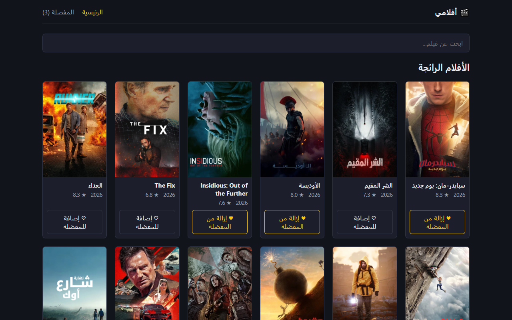
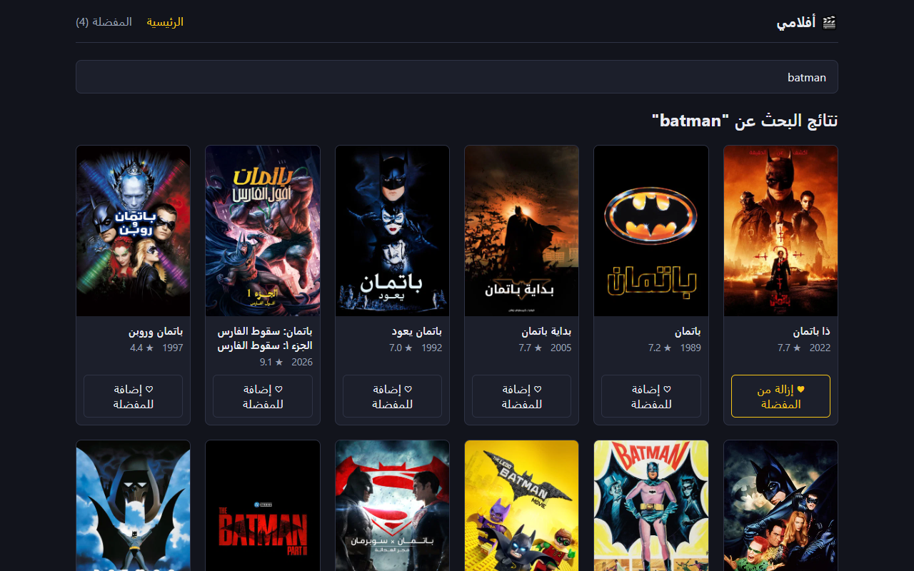
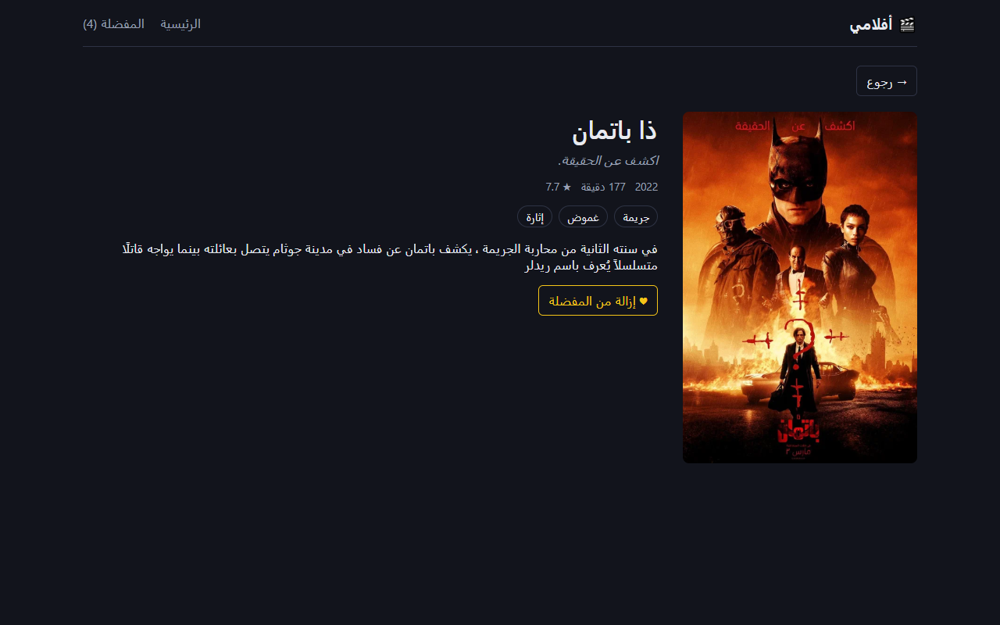

# My Films

A small movie browser I built while learning React Router. You can search for movies, open a page for each one, and keep a list of favorites.

Live demo: https://myfilms.wasmer.app/

The interface is in Arabic (right to left), and movie data is requested in Arabic too, so some titles fall back to English when TMDB has no translation.

## Screenshots

Popular movies on the home page:



Searching:



Movie page:



Favorites:


## What it does

- Shows popular movies when the search box is empty
- Searches TMDB as you type (with a short delay so it doesn't fire on every key)
- Keeps the search text in the URL, so going back from a movie page returns you to the same results
- Has a details page per movie at `/movie/:id` with poster, year, runtime, genres, rating and overview
- Saves favorites in `localStorage`, so they are still there after a refresh

## Built with

- React 19
- React Router 7
- Vite
- [TMDB API](https://developer.themoviedb.org/docs) for the data

No UI library, the styling is plain CSS in one file.

## Running it locally

You need Node.js and a free TMDB API key. You get the key from your TMDB account under Settings > API.

```bash
git clone <repo-url>
cd movie-app
npm install
```

Create a file called `.env` in the project root:

```
VITE_TMDB_KEY=your_key_here
```

Then start the dev server:

```bash
npm run dev
```

and open http://localhost:5173.

If you change `.env` while the server is running, restart it. Vite only reads that file on startup.

## Project structure

```
src/
  api/tmdb.js              all the TMDB requests
  components/              MovieCard, MovieGrid, FavoriteButton
  context/                 favorites state shared between pages
  hooks/useDebounce.js     delays the search while typing
  pages/                   Home, MovieDetails, Favorites
  App.jsx                  navbar and routes
  main.jsx                 router and provider setup
```

## Building

```bash
npm run build
```

The output goes to `dist/`. Since routing happens in the browser, the host has to serve `index.html` for every path, otherwise refreshing a movie page gives a 404.

## Things I'd like to add

- Trailers on the movie page
- Pagination or infinite scroll for search results
- A language switch between Arabic and English

## Notes

The API key ends up in the built JavaScript, which is fine for a free TMDB key but would not be for anything sensitive. That would need a small backend in front of the API.

This product uses the TMDB API but is not endorsed or certified by TMDB.
